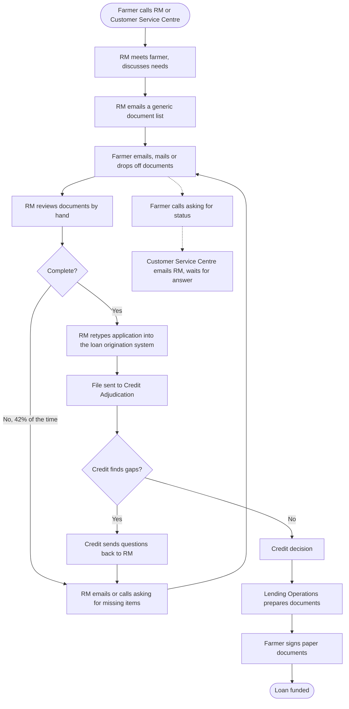

# Current State Process (As Is, Q4 2024)
## Loan Application Workflow

Mapped in three workshops with RMs, Credit Adjudication, Lending Operations and the Customer Service Centre (November 2024).

## Pain points found

| # | Pain point | Who feels it | Evidence |
|---|---|---|---|
| P1 | Generic document list does not fit the loan type, so farmers send the wrong things | Farmers, RMs | 42% of applications incomplete at first submission |
| P2 | Documents arrive by email, mail and in person, scattered across inboxes | RMs | RMs spend about 2 hours per application finding and sorting documents |
| P3 | Back and forth for missing items | Farmers, RMs | 3.4 follow ups on average per incomplete application |
| P4 | Data retyped into the LOS | RMs, Credit, Lending Ops | 7% of files have a data entry error; errors found late cause rework at funding |
| P5 | Credit finds gaps the RM missed | Credit, RMs | 1 in 4 files returned from Credit with questions |
| P6 | Nobody outside the RM can see status | Farmers, Customer Service Centre | About 2,300 status calls a month; average 2 days to get an answer |
| P7 | Paper signing | Farmers, Lending Ops | Adds 3 to 5 business days, especially in remote areas |
| P8 | Seasonal peaks overwhelm RMs | RMs | Decision time rises to 30+ days in spring |

## Where the time goes (average application, 21 business days to decision)

| Stage | Business days |
|---|---|
| Waiting for the first set of documents | 5 |
| Follow ups for missing items | 7 |
| RM review and retyping into LOS | 3 |
| Credit queue and review | 4 |
| Credit questions back to RM | 2 |
| **Total** | **21** |

**Insight:** 12 of the 21 days (57%) are spent collecting documents and chasing missing ones. Credit itself takes only 4 days. The biggest gain is in getting a complete file the first time, not in making Credit faster.
