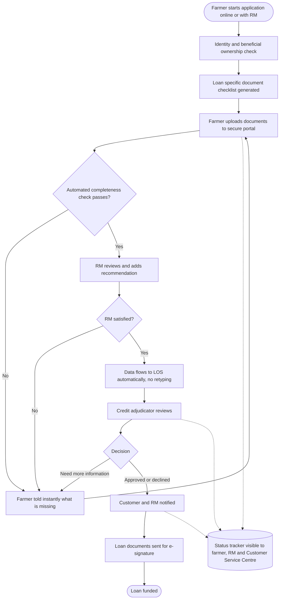

# Future State Process (To Be)
## Loan Application Workflow

Agreed with Credit, Lending Operations, Compliance and the RM advisory group, January 2025. Editable version: [diagrams/future_state_loan_workflow.drawio](diagrams/future_state_loan_workflow.drawio) (open at app.diagrams.net).

## What changes, step by step

| Step | Current state | Future state | Pain point solved |
|---|---|---|---|
| Start | Phone call or meeting only | Online any time, or with RM | P8 |
| Checklist | Generic emailed list | Generated from loan type and farm structure | P1 |
| Documents | Email, mail, drop off | One secure portal, upload from phone | P2 |
| Completeness | RM checks by hand, often later | Automated check at upload, instant feedback | P3, P5 |
| Data entry | RM retypes into LOS | Data flows automatically | P4 |
| Status | Only the RM knows | Shared tracker | P6 |
| Signing | Paper, in person | E-signature | P7 |

## What does not change (guardrails)

* A credit professional makes every credit decision.
* The RM still reviews every application and adds a recommendation.
* Identity and beneficial ownership checks happen before documents are collected.

## Controls built into the new process

| Control | Prevents |
|---|---|
| Identity check before checklist | Applications from unverified parties |
| Completeness rules agreed with Credit | Thin files reaching Credit |
| RM review gate | Automation replacing judgement |
| Automatic data transfer with validation | Data entry errors |
| Audit trail on every document and status change | Disputes and audit gaps |
