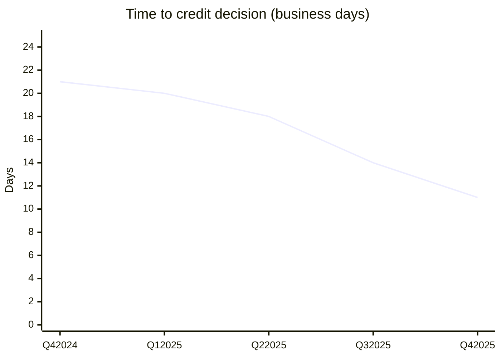

# 2025 Results
## Loan Application Workflow Domain

Measured over Q4 2025 (October 1 to December 12), after all three releases were live.

## Key results

| Key result | Baseline (Q4 2024) | Target | Result (Q4 2025) | Status |
|---|---|---|---|---|
| KR1 Time to credit decision | 21 business days | 10 | **11** | 🟠 Close (91% of the way) |
| KR2 First time complete applications | 58% | 85% | **84%** | 🟠 Close (96% of the way) |
| KR3 Application CSAT | 68% | 80% | **81%** | 🟢 Met |
| KR4 RM admin hours per application | 6.5 | 4.0 | **4.1** | 🟠 Close (96% of the way) |
| KR5 LOS data entry errors | 7% | under 2% | **1.6%** | 🟢 Met |
| KR6 Status calls per month | 2,300 | 1,150 | **1,050** | 🟢 Met |

"Percentage of the way" = (baseline − result) ÷ (baseline − target). OKRs are meant to stretch; reaching about 70% or more of a stretch target is normally treated as a strong result.

## Where the 10 days came from

| Stage | Before (days) | After (days) | What changed it |
|---|---|---|---|
| Waiting for first documents | 5 | 2 | Loan specific checklist, upload from phone (F1, F3) |
| Follow ups for missing items | 7 | 2 | Completeness check at upload (F4) |
| RM review and data entry | 3 | 2 | No retyping (F5) |
| Credit queue and review | 4 | 4 | Not in scope; unchanged as expected |
| Credit questions back to RM | 2 | 1 | Files arrive complete |
| **Total** | **21** | **11** | |

## Other results

* Files returned by Credit with questions: 25% → **9%**
* RM override rate on completeness checks: **3.8%**
* Applications started in the portal: **89%**
* About **33,600 RM hours** a year freed for advice (14,000 applications × 2.4 hours saved)
* 0 privacy or security incidents; all privacy impact assessments completed before release

## Why KR1 missed by one day, and what's next

Credit's own review time (4 days) was out of scope and did not change. Now that files arrive complete, the 2026 plan includes a joint review with Credit Adjudication of queue time during peak season, plus F8 land loans and F11 pre filled renewals.
